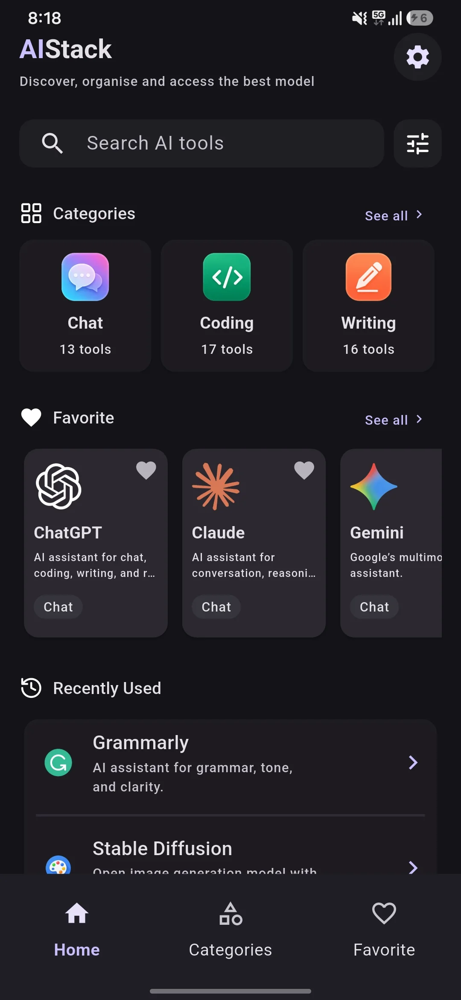
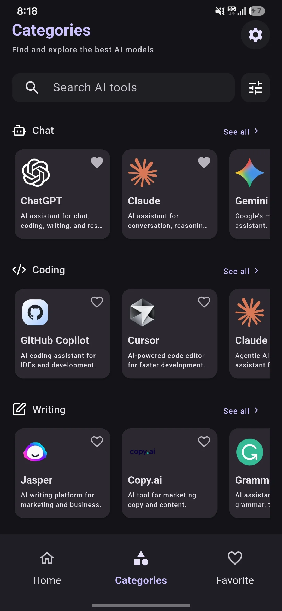
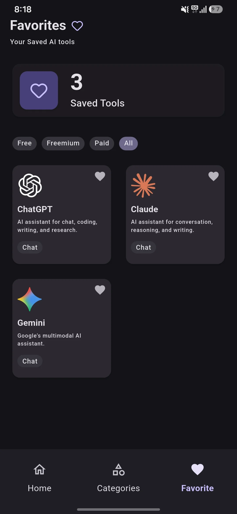
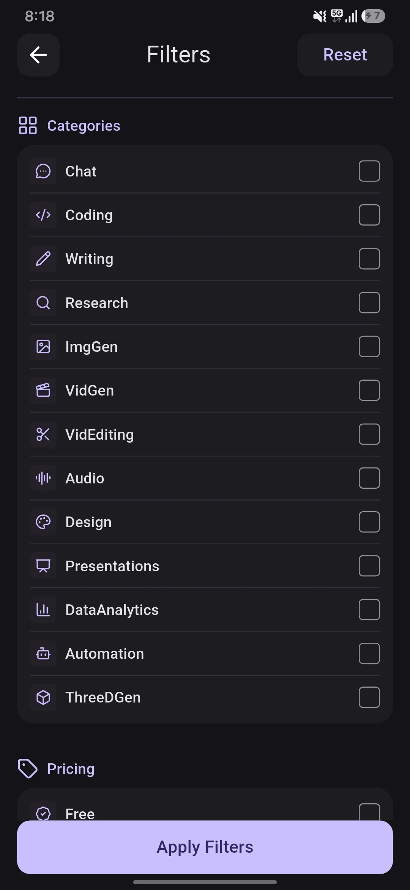

# AIStack

AIStack is a Flutter-based AI tool discovery app that brings a growing collection of AI tools into one organized platform.

The goal is simple: make it easier to discover the right AI tool without having to search through dozens of websites and apps.

**Available on Google Play:**  
https://play.google.com/store/apps/details?id=com.mohdgulfam.aistack

## Screenshots

<p align="center">
  
  
  
</p>

<p align="center">
  
  
</p>

## Features

- Discover AI tools from different categories in one place.
- Browse tools by category and use case.
- Search for AI tools quickly.
- Filter tools based on available pricing and other supported options.
- Save useful tools to favorites.
- Keep track of recently used tools.
- Open AI tools directly from the app.
- View details and basic information about individual tools.
- Support for light and dark appearance.
- Local storage for user activity such as favorites and recently used tools.

## AI Tool Categories

AIStack organizes tools across a wide range of categories, including:

- Chat
- Coding
- Writing
- Research
- Image Generation
- Video Generation
- Video Editing
- Audio
- Automation
- Design
- Presentations
- Data Analytics
- 3D Generation

The app includes tools from many well-known AI and creative platforms, including ChatGPT, Gemini, Claude, Cursor, GitHub Copilot, Midjourney, Runway, ElevenLabs, Canva, Perplexity, NotebookLM, and others.

AIStack is a discovery platform. Individual AI tools are provided and operated by their respective companies, and their pricing, availability, features, and terms may change independently.

## Tech Stack

- Flutter
- Dart
- Riverpod
- SharedPreferences / local persistence
- Material Design and Flutter theming
- Kotlin for Android platform integration
- Swift/Xcode for iOS platform integration
- Native Flutter runners for desktop platforms

## Architecture

AIStack follows a feature-based Flutter architecture. Application code is separated into features, shared widgets, models, repositories, providers, and core utilities.

```text
lib/
├── core/
│   ├── constants/
│   ├── theme/
│   └── utils/
│
├── data/
│   ├── profile_screen_data/
│   ├── repositories/
│   ├── serives/
│   ├── about_screen_data.dart
│   └── ai_tool_data.dart
│
├── features/
│   ├── about_screen.dart/
│   ├── categories/
│   ├── category_details/
│   ├── favorites/
│   ├── filters/
│   ├── home/
│   ├── navigation/
│   ├── profile/
│   ├── search/
│   ├── setting/
│   ├── settings/
│   ├── shared/
│   └── tab/
│
├── models/
│   ├── about_screen_tile.dart
│   ├── ai_tool.dart
│   ├── filter_settings.dart
│   ├── filter_state.dart
│   ├── profile_action.dart
│   ├── profile_stats.dart
│   └── tools_categories_model.dart
│
└── main.dart
```

### State Management

Riverpod is used to manage application and feature-specific state. Providers are organized alongside the features they belong to, including:

- Home
- Favorites
- Filters
- Category details
- Navigation
- Settings

This keeps feature logic separated and makes the project easier to maintain as the application grows.

## Project Structure

The repository follows the standard Flutter project structure:

```text
aistack/
├── android/
├── assets/
│   ├── icons/
│   ├── logos/
│   ├── screenshots/
│   ├── about AIStack.webp
│   └── app_logo.webp
├── ios/
├── lib/
├── linux/
├── macos/
├── test/
├── web/
├── windows/
├── analysis_options.yaml
├── pubspec.yaml
├── pubspec.lock
└── README.md
```

### Assets

The `assets` directory contains the visual resources used throughout the application.

```text
assets/
├── icons/          # AI category icons
├── logos/          # AI tool logos
├── screenshots/    # Application screenshots
├── about AIStack.webp
└── app_logo.webp
```

## Main Application Sections

### Home

The home screen provides quick access to categories, favorites, and recently used tools.

### Categories

Users can browse AI tools by category and open a dedicated category page.

### Category Details

The category details screen displays tools belonging to a selected category and provides supported sorting and pricing options.

### Search

The search feature allows users to find AI tools without manually browsing through the complete catalog.

### Favorites

Users can save tools they want to access again. Favorite data is stored locally on the device.

### Filters

The filter system allows users to narrow down available tools using supported categories, pricing options, and sorting preferences.

### Recently Used

AIStack keeps track of recently opened tools so users can quickly return to tools they have already explored.

### Profile and Settings

The profile and settings sections provide application preferences, theme controls, and activity-related information.

## Local Data

AIStack currently uses a lightweight local-data approach.

The application includes repositories for managing information such as:

- Favorite tools
- Recently used tools
- Explored activity

This allows user-specific activity to remain available on the device without requiring a user account or a dedicated backend for these features.

## Google Play

AIStack is available on Google Play.

**Package name:** `com.mohdgulfam.aistack`

**Download:**  
https://play.google.com/store/apps/details?id=com.mohdgulfam.aistack

## Developer

**MOHD GULFAM**

AIStack is an independent Flutter application built to make the growing AI-tool ecosystem easier to discover and navigate.

## Copyright and Usage

This project is shared for **learning and inspiration**. You are welcome to explore the source code, understand how it works, and use it as a reference for your own projects.

Please do not copy the entire AIStack app and publish it as your own app on the Google Play Store.

---

**AIStack — Discover AI. Find the right tools.**
